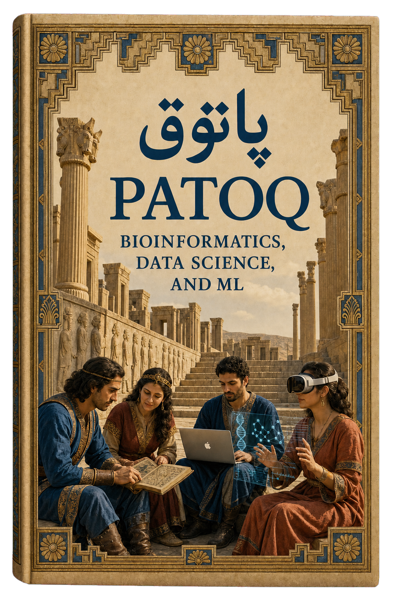

::::: {.patoq-home}
:::: {.patoq-hero}
::: {.patoq-hero-copy}
# Welcome {.unnumbered}

::: {.patoq-kicker}
BIOINFORMATICS · DATA SCIENCE · MACHINE LEARNING
:::

::: {.patoq-intro}
**PATOQ (پاتوق)** is a living field guide to bioinformatics, computational biology, data science, and machine learning.

It turns scattered resources into clear learning paths, practical workflows, and carefully curated references.
:::

::: {.patoq-byline}
Curated by [Arash B. Abadi](https://arashabadi.github.io/) and [Hossein Asadkhanipour](https://github.com/h-asadkhanipour)
:::

::: {.patoq-actions}
[Explore the interactive map](learning-map.qmd){.btn .btn-outline-primary}
[Start learning](prerequisites.qmd){.btn .btn-primary}
[Contribute on GitHub](https://github.com/arashabadi/patoq/blob/main/CONTRIBUTING.md){.btn .btn-outline-primary}
:::
:::

::: {.patoq-cover-panel}
{.patoq-cover-art fig-alt="PATOQ scholars at Persepolis combining manuscripts with modern computing"}

**Persepolis, Fars, Iran.** The cover imagines an ancient gathering place reactivated for modern science. [About Persepolis →](https://whc.unesco.org/en/list/114)
:::
::::

## Choose a path {.unnumbered}

:::: {.patoq-paths}
::: {.patoq-card}
### Build the foundations

Refresh the biology, mathematics, statistics, Linux, Git, R, and Python concepts behind computational research.

[Browse prerequisites →](prerequisites.qmd)
:::

::: {.patoq-card}
### Explore biological data

Move through genomics, transcriptomics, proteomics, metabolomics, epigenomics, and metagenomics.

[Explore omics data →](omics-data.qmd)
:::

::: {.patoq-card}
### Find tools and workflows

Discover reproducible workflows, cloud and HPC resources, visualization approaches, platforms, and references.

[Open the toolkit →](integrated-platforms.qmd)
:::
::::

::: {.patoq-meta}
Open, versioned, and built with Quarto. New material is curated into the right learning path instead of added as an endless feed.
:::
:::::
